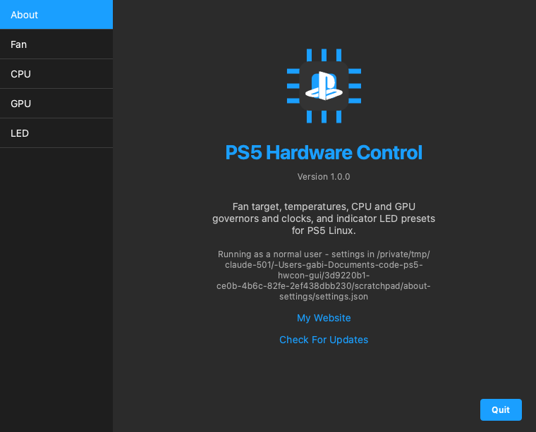

<h1 align="center">ps5-hwcon-gui</h1>

<p align="center">
  
</p>

<p align="center">
A desktop (PyQt6) port of <a href="https://github.com/NotHavocc/ps5-hwcon-plugin">ps5-hwcon-plugin</a> for
PS5 Linux. It covers the same features as the Decky plugin in a regular window: fan target and live
temperatures, CPU and GPU governors and clock locks, and indicator LED presets. Decky Loader is not
needed.
</p>

---

## Requirements

- A PS5 running Linux with the [ps5-linux-patches](https://github.com/rmuxnet/ps5-linux-patches-1)
  kernel. The app only talks to the sysfs interfaces that kernel adds.
- Python 3.9+ and PyQt6.
- Root, because every control writes to sysfs. The window shows a warning banner when it isn't
  running as root or when kernel interfaces are missing.

## Install and run

Run this on the PS5 as your normal user (not root):

```sh
curl -fsSL https://raw.githubusercontent.com/NotHavocc/ps5-hwcon-gui/main/install.sh | bash
```

To also install the headless service (see below), add `--service`:

```sh
curl -fsSL https://raw.githubusercontent.com/NotHavocc/ps5-hwcon-gui/main/install.sh | bash -s -- --service
```

From a copy of this repo, `./install.sh` (or `./install.sh --service`) does the same without
downloading anything.

Run the same command again to update. Your settings are kept. To uninstall:

```sh
curl -fsSL https://raw.githubusercontent.com/NotHavocc/ps5-hwcon-gui/main/install.sh | bash -s -- --uninstall
```

Once installed, open it from the app menu or a terminal:

```sh
ps5-hwcon-gui          # open the window
ps5-hwcon-gui --tray   # start hidden in the tray
```

Settings are stored in `/var/lib/ps5-hwcon/settings.json` when running as root, otherwise in
`~/.config/ps5-hwcon/`. Set `PS5HWCON_SETTINGS_DIR` to use another directory.

### Background protection and Restore on Startup

You have two options:

- **Keep the app in the tray.** Closing the window hides it to the system tray and the background
  tasks keep running. Use **Quit** in the window or the tray menu to exit.
- **Install the headless service** with `./install.sh --service`. It restores saved settings at
  boot and runs the background tasks without a window.

Only one instance can run at a time, because two thermal guards would fight over the fan target.
To change settings while the service is running, stop it (`sudo systemctl stop ps5-hwcon`), use the
GUI, then start the service again.

## Features

### Fan

- **Temperatures**: live CPU (`k10temp`), GPU, SSD and any other hwmon sensors, refreshed every 2 s
  and colored as they approach the overheat threshold.
- **Presets**: Quiet 85 °C, Default 80 °C, Balanced 72 °C, Cool 65 °C and Max Cooling 50 °C.
- **Manual Target**: any target from 40 to 90 °C.
- **Restore on Startup**: re-applies your last target when the app or service starts. The kernel
  resets it to 80 °C on every boot.
- **Thermal Guard**: when the CPU reaches the Overheat Threshold (80–100 °C, default 95), the fan
  switches to Max Cooling. Your target comes back once the CPU is 10 °C cooler.
- **Overheat Alarm**: plays the console's error beep once when the CPU reaches the threshold, and
  re-arms after it cools down.

### CPU

- **Governor**: every cpufreq governor the kernel offers, applied to all CPUs.
- **Status**: active governor (or **Mixed**), average and peak clock, hardware range and driver.
- **Manual Clock**: locks every CPU to one clock (`scaling_min_freq` = `scaling_max_freq`). The
  slider snaps to `scaling_available_frequencies` when the driver lists them. **Automatic** restores
  the full range.
- **Restore on Startup**: re-applies your last governor and clock lock.

### GPU

- **Governor**: the devfreq governors offered by `ps5-gpufreq` (Ondemand, Performance, Powersave,
  Userspace).
- **Status**: active governor, current and target clock, allowed range.
- **Manual Clock**: locks the GPU to one of `available_frequencies`. **Automatic** removes the
  limits.
- **Restore on Startup**: re-applies your last GPU governor and clock lock.

GPU governors need a kernel built with `CONFIG_PS5_GPUFREQ`. While the CPU boosts (3.3–3.5 GHz) the
firmware holds the GPU at 2.23 GHz regardless of these settings.

### LED

- Quick buttons for Off, White Bright, Blue Rich, Purple, Orange Breathe and Pink Breathe.
- A filterable list of every preset the kernel exposes.
- **Loop Animations**: replays breathe and pulse animations every 2–30 s, in the background.

## Single-file builds

GitHub Actions (`.github/workflows/release.yml`) builds `ps5-hwcon-gui-linux-x86_64`, one
executable with Python and Qt bundled, so the PS5 needs no Python or pip. Every push and pull
request builds it and checks that it starts; the file is attached to the run as an artifact.

To publish a release, set `__version__` in `ps5hwcon/__init__.py`, then push a matching tag:

```sh
git tag v1.0.0
git push origin v1.0.0
```

The workflow creates the GitHub release and attaches the binary and its SHA-256 checksum. On the
PS5:

```sh
chmod +x ps5-hwcon-gui-linux-x86_64
sudo -E ./ps5-hwcon-gui-linux-x86_64            # or --headless, --tray
```

To build it yourself on Linux x86_64, run `packaging/build_binary.sh` (see the comment at its top).

## Credits

- [NotHavocc/ps5-hwcon-plugin](https://github.com/NotHavocc/ps5-hwcon-plugin), which this is ported
  from. (haha credit to myself)
- [NotHavocc/PinkDesktopPet](https://github.com/NotHavocc/PinkDesktopPet), where the GUI was ported from (haha credit to myself again)
- [rmuxnet/ps5-linux-patches](https://github.com/rmuxnet/ps5-linux-patches-1) for the kernel drivers.
