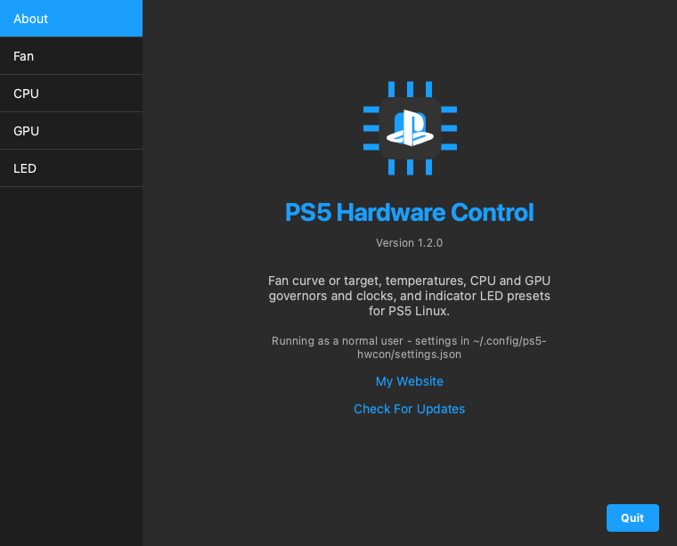
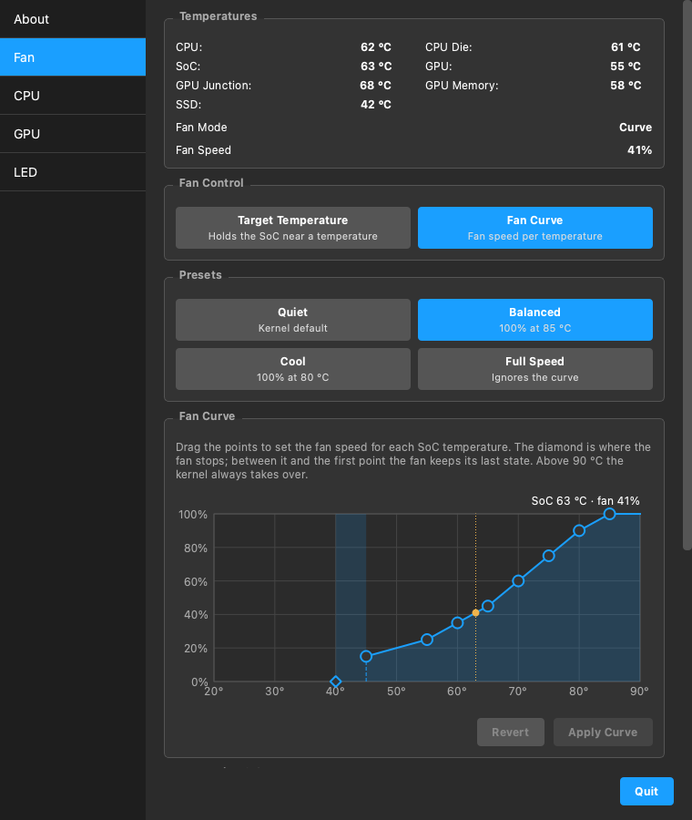

<h1 align="center">ps5-hwcon-gui</h1>

<p align="center">
  
  &nbsp;
  
</p>

<p align="center">
A desktop (PyQt6) port of <a href="https://github.com/NotHavocc/ps5-hwcon-plugin">ps5-hwcon-plugin</a> for
PS5 Linux. It covers the same features as the Decky plugin in a regular window: fan curve or
target, live temperatures, CPU and GPU governors and clock locks, GPU memory, zram and zswap, and
indicator LED presets. Decky
Loader is not needed.
</p>

---

## Requirements

- A PS5 running Linux with the [ps5-linux-patches](https://github.com/ps5-linux/ps5-linux-patches)
  kernel. The app only talks to the sysfs interfaces that kernel adds.
- Python 3.9+ and PyQt6.
- Root, because every control writes to sysfs. The window shows a warning banner when it isn't
  running as root or when kernel interfaces are missing.

## Install and run

Run this on the PS5 as your normal user (not root):

```sh
curl -fsSL https://raw.githubusercontent.com/NotHavocc/ps5-hwcon-gui/main/install.sh | bash
```

From a copy of this repo, `./install.sh` does the same without downloading anything.

Run the same command again to update. Your settings are kept. To uninstall:

```sh
curl -fsSL https://raw.githubusercontent.com/NotHavocc/ps5-hwcon-gui/main/install.sh | bash -s -- --uninstall
```

Once installed, open it from the app menu or a terminal:

```sh
ps5-hwcon-gui          # open the window
ps5-hwcon-gui --tray   # start hidden in the tray
```

The app needs root, so it asks for your password each time it opens. To skip that, add
`--passwordless` to the install command:

```sh
curl -fsSL https://raw.githubusercontent.com/NotHavocc/ps5-hwcon-gui/main/install.sh | bash -s -- --passwordless
```

This adds a sudoers rule for your user that only covers opening this app, and updates keep it. The
trade-off is that anything running as your user can then open the app as root without a password.
Run the installer with `--no-passwordless` to remove the rule.

Settings are stored in `/var/lib/ps5-hwcon/settings.json` when running as root, otherwise in
`~/.config/ps5-hwcon/`. Set `PS5HWCON_SETTINGS_DIR` to use another directory.

### Background protection and Restore on Startup

Thermal Guard, Overheat Alarm and LED loops run inside the app. Closing the window hides it to the
system tray and they keep running. Use **Quit** in the window or the tray menu to exit, which stops
them. Settings you applied stay in place until you reboot. The desktop's tray won't accept an icon
from root, so the icon is shown by a small helper process that runs as you and closes with the app.

To have all of this from the moment you log in, turn on **Start in Tray at Login** on the About page.
It adds `~/.config/autostart/ps5-hwcon-gui.desktop`, which runs `ps5-hwcon-gui --tray`. The app
needs root, so install with `--passwordless` or you'll be asked for your password at each login. It
needs a desktop with a system tray, and waits up to 15 s for the tray to appear after login.
Uninstalling removes the login item.

Restore on Startup re-applies saved settings when the app starts, each one as soon as its driver is
ready. If a driver is still loading, it keeps retrying for up to 60 s and logs which settings it is
waiting for, or gave up on.

Only one instance can run at a time, because two thermal guards would fight over the fan target.

## Features

### Fan

**Fan Control** switches between **Target Temperature** (the original control) and **Fan Curve**.
Fan curves need a kernel with the `ps5_fan` hwmon driver, which ps5-linux-patches includes from
7.2.3 ([#60](https://github.com/ps5-linux/ps5-linux-patches/pull/60)). The app and installer look
for that device rather than the kernel version, so any kernel carrying the driver works. Without it
the page opens on Target Temperature and Fan Curve is greyed out. Kernels with the driver drop
`target_temp`, so there a target is applied as a curve that reaches 45% at the target and full speed
6 °C above it.

- **Temperatures**: live CPU (`k10temp`), GPU, SSD and any other hwmon sensors, refreshed every 2 s
  and colored as they approach the overheat threshold.
- **Fan curve** (hwmon kernels): drag the 8 curve points (SoC temperature → fan speed) and the
  stop temperature, then **Apply Curve**. The editor keeps the curve valid for the driver:
  temperatures rise from point to point, speed never drops, and the last point is 100%. Above
  90 °C the kernel runs the fan at full speed no matter what.
- **Curve presets**: Quiet (the kernel default), Balanced, Cool, and Full Speed.
- **Target presets**: Quiet 85 °C, Default 80 °C, Balanced 72 °C, Cool 65 °C and
  Max Cooling 50 °C.
- **Manual Target**: any target from 40 to 90 °C.
- **Restore on Startup**: re-applies your last curve or target when the app starts. The
  kernel resets both on every boot.
- **Thermal Guard**: when the CPU reaches the Overheat Threshold (80–100 °C, default 95), the fan
  switches to Full Speed (or the Max Cooling target). Your setting comes back once the CPU is
  10 °C cooler.
- **Overheat Alarm**: plays the console's error beep once when the CPU reaches the threshold, and
  re-arms after it cools down.

### CPU

- **Governor**: every cpufreq governor the kernel offers, applied to all CPUs.
- **Status**: active governor (or **Mixed**), average and peak clock, hardware range and driver.
- **Manual Clock**: locks every CPU to one clock (`scaling_min_freq` = `scaling_max_freq`). The
  slider snaps to `scaling_available_frequencies` when the driver lists them. **Automatic** restores
  the full range.
- **Restore on Startup**: re-applies your last governor and clock lock.

### GPU

- **Governor**: the devfreq governors offered by `ps5-gpufreq` (Ondemand, Performance, Powersave,
  Userspace).
- **Status**: active governor, current and target clock, allowed range.
- **Manual Clock**: locks the GPU to one of `available_frequencies`. **Automatic** removes the
  limits.
- **Restore on Startup**: re-applies your last GPU governor and clock lock.

- **CU Unlock**: turns on the compute units disabled at the factory (36 or 38 active out of 40). **40
  CUs** adds `amdgpu.ps5_cu_unlock=3` to `cmdline.txt` on the boot drive, and **38 CUs** also adds
  `amdgpu.disable_cu=0.0.0` to mask one pair, so both need a reboot. **Off** removes both arguments,
  including a `disable_cu` you added yourself. The previous file is kept as `cmdline.txt.bak`.
  **Active CUs** shows the count the driver reported. Only an even split across both shader engines
  helps performance, so 38 CUs usually scores the same as 36. Some disabled CUs can be faulty, and
  the pair masked for 38 CUs is always the same one, so it may not avoid them. If you see glitches,
  try `RADV_DEBUG=nohiz`, then turn this off. If the screen is unusable, remove the arguments over
  SSH or from another computer.
- **Apply Now** (experimental): applies a CU Unlock change without a reboot by reloading amdgpu. It
  closes everything on screen and quits this app, so it needs `amdgpu` built as a module and a
  systemd display manager. Without those, only the reboot works. If something else is still using
  the GPU the driver can't unload, and the display comes back with nothing changed. See
  `journalctl -u ps5-hwcon-cu-reload` for what happened.
- **Boot partition**: CU Unlock, GPU Memory and zswap edit files on the FAT partition the console booted
  from, wherever the distro or desktop mounted it. If it isn't mounted, the app mounts it read-only
  at `/boot/efi` (or `/run/ps5-hwcon/boot` if that's taken), and only makes it writable while
  saving. It picks the partition whose `cmdline.txt` has the running `root=` argument. If it can't
  find one, or can't tell which one that is, the GPU or Memory page shows why.
GPU governors need a kernel built with `CONFIG_PS5_GPUFREQ`. The driver isn't part of
[ps5-linux-patches](https://github.com/ps5-linux/ps5-linux-patches) itself, so on those kernels the
GPU tab shows why it's unavailable and everything else works normally. While the CPU boosts (3.3–3.5 GHz) the
firmware holds the GPU at 2.23 GHz regardless of these settings.

### Memory

- **Overview**: live RAM and swap usage, including each swap device.
- **GPU Memory**: **VRAM** writes `vram.txt` on the boot drive, in the hex format the loader expects,
  and warns if the existing value looks wrong. It's a minimum that stays reserved from system RAM.
  6 GB is the recommended choice for gaming; pick 512 MB on a desktop or server that doesn't game,
  or enter any size from 0.25 to 12 GB under **Custom**. **GTT Limit** sets `ttm.pages_limit` in
  `cmdline.txt`, which raises how much system RAM the GPU can use without reserving it, so try this
  if a game runs out of memory. Both need a reboot. See the
  [wiki](https://wiki.ps5-linux.eu/post-install/all-distros/#memory-and-swap) for how the two
  interact.
- **zram**: turns compressed swap in RAM on or off and sets its size and compression, by writing
  `/etc/systemd/zram-generator.conf` (the previous file is kept as `.bak`). Needs `zram-generator`
  and a reboot. Turning it off writes a config without a device, which also masks a distro default.
- **zswap**: switches zswap on or off immediately and saves `zswap.enabled` in `cmdline.txt`. It only
  helps with swap on a drive, so leave it off when using zram.

### LED

- Quick buttons for Off, White Bright, Blue Rich, Purple, Orange Breathe and Pink Breathe.
- A filterable list of every preset the kernel exposes.
- **Active Preset** survives closing and reopening the app. After a reboot it shows Unknown until
  you pick a preset (or Restore on Startup does), because the kernel picks its own default LED.
- **Loop Animations**: replays breathe and pulse animations every 2–30 s, in the background.
- **Restore on Startup**: re-applies your last LED preset when the app starts.

## Single-file builds

GitHub Actions (`.github/workflows/release.yml`) builds `ps5-hwcon-gui-linux-x86_64`, one
executable with Python and Qt bundled, so the PS5 needs no Python or pip. Every push and pull
request builds it and checks that it starts; the file is attached to the run as an artifact.

To publish a release, set `__version__` in `ps5hwcon/__init__.py`, then push a matching tag:

```sh
git tag v1.0.0
git push origin v1.0.0
```

The workflow creates the GitHub release and attaches the binary and its SHA-256 checksum. On the
PS5:

```sh
chmod +x ps5-hwcon-gui-linux-x86_64
sudo -E ./ps5-hwcon-gui-linux-x86_64            # or --tray
```

To build it yourself on Linux x86_64, run `packaging/build_binary.sh` (see the comment at its top).

## Credits

- [NotHavocc/ps5-hwcon-plugin](https://github.com/NotHavocc/ps5-hwcon-plugin), which this is ported
  from. (haha credit to myself)
- [NotHavocc/PinkDesktopPet](https://github.com/NotHavocc/PinkDesktopPet), where the GUI was ported from (haha credit to myself again)
- [rmuxnet/ps5-linux-patches](https://github.com/rmuxnet/ps5-linux-patches-1) for the kernel drivers.
